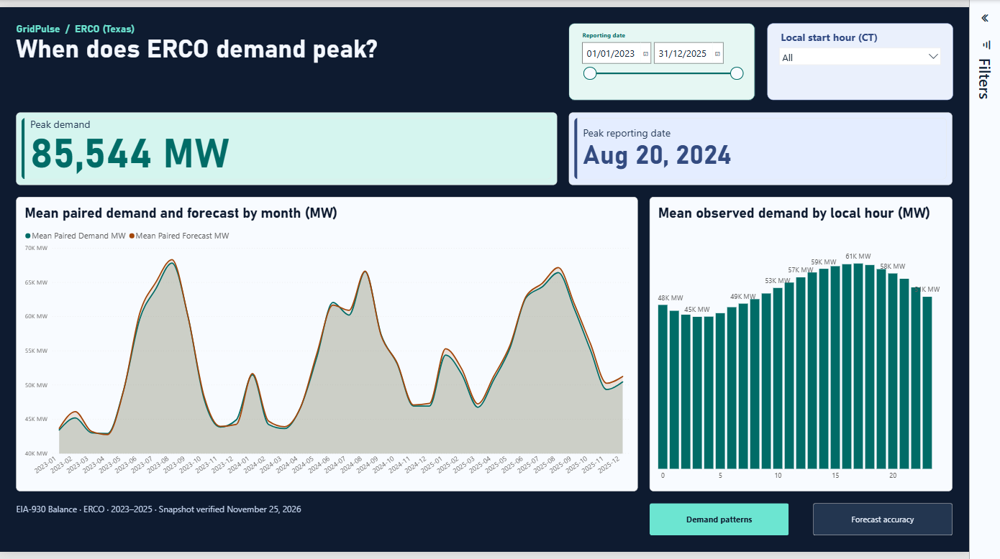
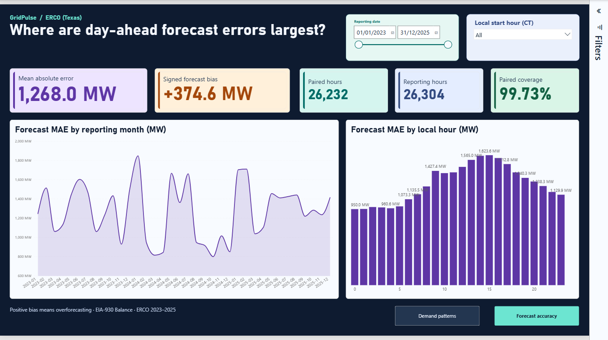

# GridPulse — Electricity demand and forecast accuracy

GridPulse is an analytics engineering portfolio project using hourly
electricity data from **EIA-930** for the ERCO balancing authority in Texas
from 2023 to 2025. It uses BigQuery Sandbox and dbt Core to validate and model
the historical data, then delivers interactive reports in Power BI Desktop.

## Dashboard

The two pages answer when demand peaks and where day-ahead forecast errors
are largest. Both can be filtered by EIA reporting date and local hour.

**Open an editable report in Power BI Desktop.**
[GridPulse Color](powerbi/GridPulse%20Color.pbip) and the
[original light design](powerbi/GridPulse.pbip) share the same model.
To refresh either report, follow the
[rebuild and refresh guide](docs/phase-8-release.md#reproduce-the-report).

## Findings

| Measure | Verified result |
| --- | ---: |
| Hourly records | 26,304 |
| Hours with both demand and forecast | 26,232 (99.73%) |
| Observed peak demand | 85,544 MW on August 20, 2024 |
| Mean absolute day-ahead forecast error | 1,268.0 MW |
| Mean forecast minus demand | +374.6 MW |

The positive mean error indicates average overforecasting during paired
hours. Averages can hide variation by period and hour. The dashboard
shows how absolute error varies across months and local hours.
The results describe this historical ERCO snapshot.

## Data flow and checks

    Six EIA-930 Balance files → verified ERCO CSV → BigQuery raw table
        → dbt staging and hourly fact views → bounded CSV export
        → shared Import model and two Power BI reports

Python verifies the source hashes and prepares the warehouse input. dbt
checks UTC uniqueness, source coverage, reporting hours, and consistency
from raw to fact. Power BI uses a calendar and DAX measures to summarize
coverage, observed peak, and forecast error.

The BigQuery project used Sandbox with billing unlinked. The reports
were refreshed in Power BI Desktop. GitHub Actions uses the same
[offline check command](scripts/check_ci.py) that was tested from a clean
clone. Terraform and cloud-connected CI are deferred for the single
Sandbox. See the [validation record](docs/validation/phase-8-release.md)
for measured evidence and limitations.

## Where to read next

Use the document that matches your question:

| If you want to know... | Read |
| --- | --- |
| What is true right now? | [CURRENT_STATE.md](CURRENT_STATE.md) |
| What is this project supposed to become? | [PROJECT_SPEC.md](PROJECT_SPEC.md) |
| How is the system intended to work? | [ARCHITECTURE.md](ARCHITECTURE.md) |
| What phases are planned? | [ROADMAP.md](ROADMAP.md) |
| Why was a technical choice made? | [DECISIONS.md](DECISIONS.md) |
| How should an AI assistant work in this repo? | [AGENTS.md](AGENTS.md) |
| What should be loaded for a specific task? | [REPO_CONTEXT.md](REPO_CONTEXT.md) |

## Project documentation model

GridPulse uses the [AI Repository Context](REPO_CONTEXT.md) convention for cross-chat and cross-tool continuity.

The repository, not chat memory, is the durable source of truth.

The [GridPulse Jira project](https://angel231995.atlassian.net/browse/GRID)
tracks planned phase epics and tasks. The repository remains authoritative for
scope, decisions, phase state, authorization, and evidence. A Jira issue or
status does not start or close a phase; follow the [roadmap rules](ROADMAP.md#phase-rules).

Phase handoffs and validation evidence live under:

    docs/
    ├── handoffs/
    └── validation/

Repository documentation presentation follows the locally installed Repository Documentation Readability skill under:

    .agents/
    └── skills/
        └── repository-documentation-readability/

That guidance affects presentation only. GridPulse's own project semantics, authority rules, architecture, and lifecycle always take precedence.

## License

GridPulse's original code and documentation are available under the [MIT License](LICENSE).
Source data and third-party materials retain their own terms. See the
[source attribution and reuse notes](docs/phase-8-release.md#data-attribution).
